# Artstyle

**Status: Entwurf** zu Issue #1. Vorgeschlagen von Benedict auf Grundlage der Demo-Szene „Akademie der Alchemie – Lehrsaal“ (Stand 19.11.2026). Die Abstimmung mit Fabian (Creative, PR-04) steht aus. Alle Assets entstehen im Team, keine Fremdlizenzen ([Entscheidungen](../entscheidungen.md)).

Dieses Dokument legt fest, wie Räume, Figuren, Gegenstände und Animationen aussehen. Wie die Dateien technisch aufgebaut sind, steht im [Asset-Vertrag](../architektur/asset-vertrag/README.md). Die Prompt-Vorlagen stehen im [Briefing für Claude Design](../architektur/claude-design-briefing.md).

## Leitbild: Scherenschnitt im Dämmerlicht

- **Licht von hinten.** Jeder Raum hat eine warme Lichtquelle im Hintergrund (Fenster, Feuer, Abendhimmel). Wand und Himmel tragen den Farbverlauf, alles davor steht als Silhouette im Gegenlicht.
- **Flächen statt Linien.** Möbel und Figuren sind flächig und dunkel, ohne schwarze Konturen. Form entsteht über den Umriss und eine dünne Lichtkante an der Oberseite.
- **Farbe heißt Bedeutung.** Gesättigte Leuchtfarben kommen nur an Dingen vor, die für das Spiel zählen: Tränke, Zutaten, Kristalle, Feuer, Schlüssel. So findet der Spieler interaktive Objekte, ohne dass Hotspots markiert werden.
- **Ruhig und lesbar.** Wenige große Formen, klare Umrisse, kein Rauschen. Eine Figur muss als Silhouette erkennbar sein, auch ohne Gesicht.

## Referenz

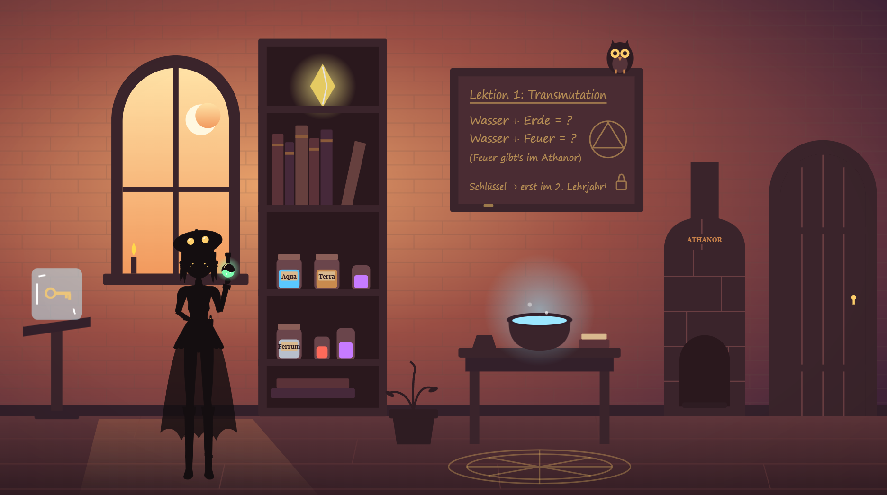

Die Demo-Szene zeigt alle Regeln dieses Dokuments: Gegenlicht durchs Fenster, Möbel als Silhouetten mit Lichtkante, die Figur ganz dunkel, Leuchtfarben nur an Spielrelevantem (Kristall, Tränke, Kessel, Schlüssel im Eis). Die Beschriftungen auf Gläsern und Tafel sind in der Demo `<text>`. Im Spiel werden sie als Pfad gezeichnet.

Die Alchemistin aus der Demo in drei Ansichten. Die Dateien sind Stilreferenz, keine Assets: Sie nutzen `<style>` und erfüllen den Asset-Vertrag nicht (siehe [Von der Demo zum Asset](#von-der-demo-zum-asset)).

| Vorn | Seite | Hinten |
|---|---|---|
| 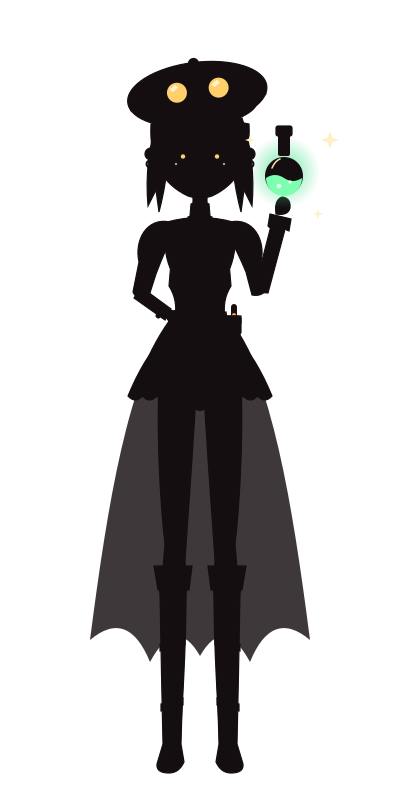 | 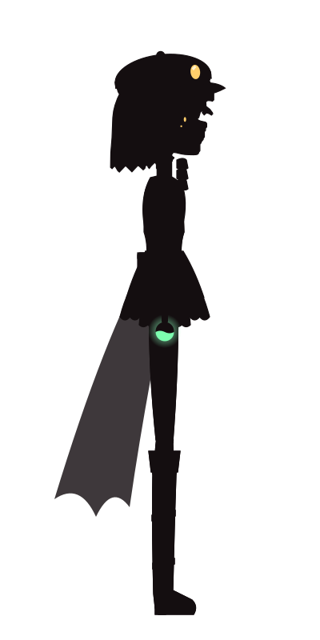 | 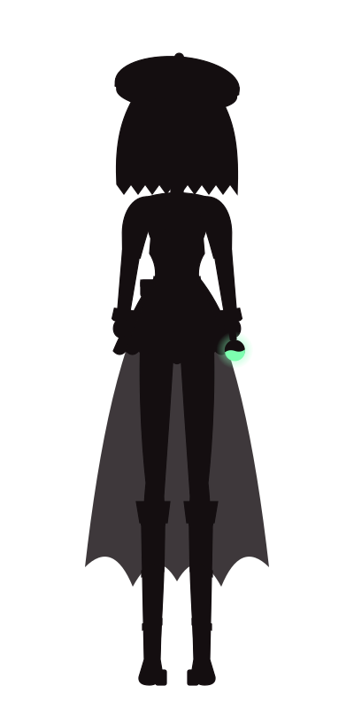 |

## Palette

Werte in `#rrggbb`. Neue Farben nur nach Absprache mit Creative.

### Licht und Hintergrund

| Rolle | Farbe | Verwendung |
|---|---|---|
| Wand, Verlauf radial | `#e8a16a` → `#9a4e44` → `#42243a` | heller Kern zur Lichtquelle, dunkel an den Rändern |
| Himmel, Verlauf vertikal | `#ffe2a6` → `#f29a5e` | Fenster, Ausblicke |
| Boden, Verlauf vertikal | `#5e353a` → `#321d24` | hinten heller als vorn |
| Lichtfleck am Boden | `#ff9a5a` (20 %) → transparent | unter der Lichtquelle |
| Mond, Lichtpunkte | `#fff8e0` | sparsam |

### Silhouetten nach Tiefe

| Stufe | Farbe | Verwendung |
|---|---|---|
| hinten | `#4a2c33` | Tafeln, Wandobjekte |
| Mitte | `#3a242b` | Möbel, Mauerwerk, Metall |
| vorn | `#2e1c22` | Töpfe, Pflanzen, Vordergrund |
| dunkle Teile | `#33202a` | Unterseiten, Sockel |
| Nischen, Öffnungen | `#2a181d` | Regalrückwand, Türloch, Ofenloch |
| Binnenlinien | `#6a3e42` | Fugen, Bretter, 1,8 Einheiten breit |
| Figur | `#140e10` | Spielfigur und Personen, dunkler als jedes Möbel |

### Lichtkante

| Rolle | Farbe | Breite |
|---|---|---|
| Hauptkante | `#d98a62` | 1,6 |
| Nebenkante | `#b5665a` | 1,3 |

Die Kante liegt als `stroke` auf der Fläche, mit `stroke-linejoin="round"`. Figuren bekommen keine Lichtkante, nur einen Umriss in Figurfarbe.

### Leuchtfarben (Spielrelevantes)

| Rolle | Farbe |
|---|---|
| Gold, Schlüssel, Augen, Linsen | `#ffcf6b` |
| Kupfer, Messing, Beschriftung | `#c9824a` |
| Alchemie grün | `#7dffb0` |
| Alchemie orange | `#ff9a4f` |
| Wasser | `#5ac8ff` |
| Erde | `#c98a4e` |
| Eisen | `#b8c0cc` |
| Trank violett | `#c77bff` |
| Trank rot | `#ff6a5a` |
| Kristall | `#ffe46b` |
| Flamme innen, außen | `#ffd84a`, `#ff8a2a` |
| Eis | `#bfe9f5` (55 %), Kante `#d8f6ff` |

Leuchtende Dinge dürfen einen weichen Schein haben: radialer Verlauf in derselben Farbe von 55–95 % Deckkraft auf 0.

### Oberfläche (UI)

| Rolle | Farbe |
|---|---|
| Seitenhintergrund | `#140e10` |
| Leiste, Inventar | `#2a1a14` |
| Schaltflächen, Felder | `#3b2620`, Rand `#5a3a2c` |
| Hervorhebung, Rahmen von Dialogen | `#e0ad4a` |
| Text | `#f6ecd8` |

Schrift: Serifenschrift aus dem System (`Georgia, "Times New Roman", serif`), keine eingebetteten Schriften. Dialogfenster und Karten haben runde Ecken (10–14 px) und einen goldenen Rahmen.

## Räume

- Perspektive: frontal mit leichter Tiefe, Boden im unteren Bilddrittel, Horizontlinie etwa bei 83 % der Höhe.
- Eine Lichtquelle je Raum, im Hintergrund. Der Wandverlauf hat dort seinen hellsten Punkt.
- Objekte nach Tiefe einfärben (Tabelle oben). Weiter vorn heißt dunkler.
- Mauerwerk und Ziegel als feines Muster mit 35 % Deckkraft, nicht als einzelne Formen.
- Eine leichte Vignette (Schwarz, außen 25 % Deckkraft) schließt das Bild ab.
- Beschriftungen (Gläser, Tafel, Schilder) in Kupfer oder Gold. Laut Asset-Vertrag sind `<text>`-Elemente verboten: Schrift als Pfad zeichnen oder weglassen.

## Figuren

- Vollständig dunkle Silhouette in `#140e10`. Gesicht, Augen und Kleidungsdetails sind nicht zu sehen.
- Proportionen im Anime-Stil: großer Kopf, schlanker Körper, betonte Haare und Kopfbedeckung. Referenz: Alchemistin, 400 × 800 Einheiten, Füße an der Unterkante.
- Wiedererkennung über den Umriss: Hut oder Frisur, Rocksaum, Stiefel, Taschen und Phiolen.
- Leuchtende Akzente sind erlaubt und erwünscht: Brillengläser in Gold, eine Phiole in einer Alchemiefarbe, Funken.
- Alle drei Ansichten (Seite, vorn, hinten) mit demselben Umriss-Stil. Die Seitenansicht blickt nach rechts.
- Personen, mit denen man spricht, unterscheiden sich durch Umriss und Akzentfarbe. Die Sprechtextfarbe (`textColor` in `character.json`) ist die Akzentfarbe der Figur.
- Keine Filter (Asset-Vertrag, Bildrate).

## Weitere Charaktere

Jede Figur ist allein am Umriss erkennbar und hat eine eigene Leuchtfarbe, die sie auch im Dunkeln unterscheidet. Alle Tonstufen einer Figur sind dunkler als die dunkelste Stelle der Szene (hellste Figurstufe höchstens `#26191d`). Neue Figuren bekommen eine noch freie Leuchtfarbe, z. B. Eisblau-Weiß, Magenta oder Smaragd.

| Figur | Körperbau, Umriss | Leuchtfarbe | Träger |
|---|---|---|---|
| Alchemistin | zierlich, Rock, Schutzbrille | `#ffcf6b`, `#7dffb0` | Brille, Augen, Trank |
| Lehrling | jugendlich, schmal, langer Mantel | `#7fe3ff` | Brillengläser, Glasröhre im Rucksack |
| Meister | kräftig, Schulterplatten mit Stacheln, breiter Stand | `#ffe066`, `#c38bff` | Reaktorkern auf der Brust, Röhren, Brille |
| Erzalchemist | gebrechlich, Buckel, stützt sich auf einen Stab | `#ffb35a` | Stabkern, Brillenränder, Monokel |
| Schmied | Hüne (Skalierung 1,28), Fassbauch, kleiner Kopf, Zange | `#ff6a3c`, Funken `#ffd27a` | glühender Barren, Funken, Brille |

| Figur | Vorn | Seite | Hinten |
|---|---|---|---|
| Lehrling | 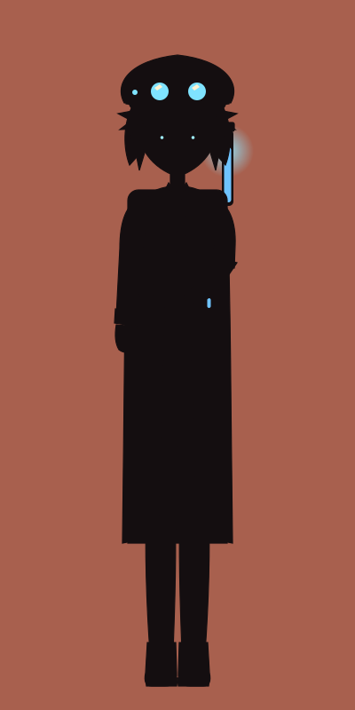 | 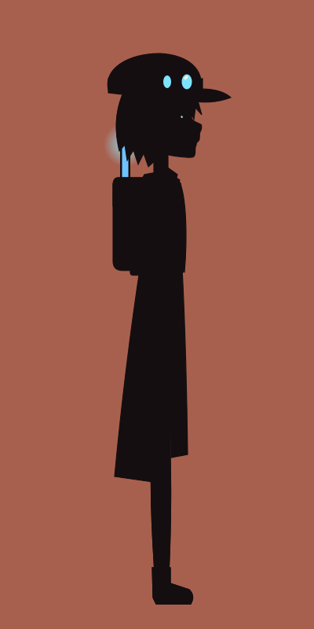 | 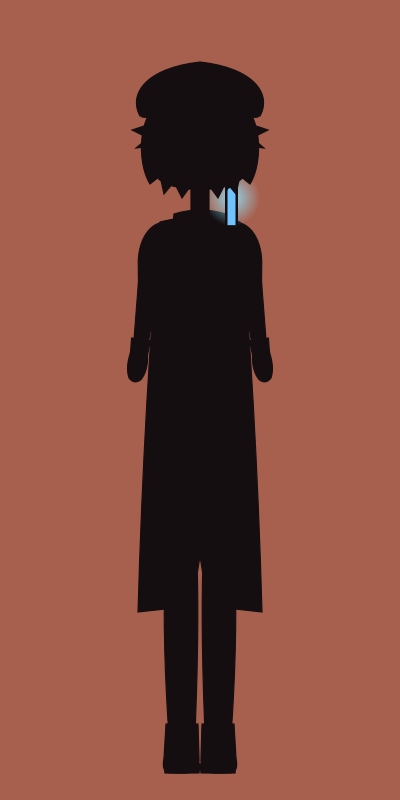 |
| Meister | 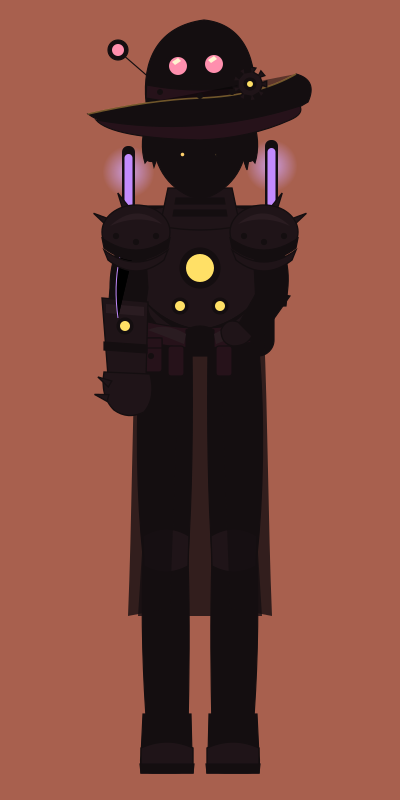 | 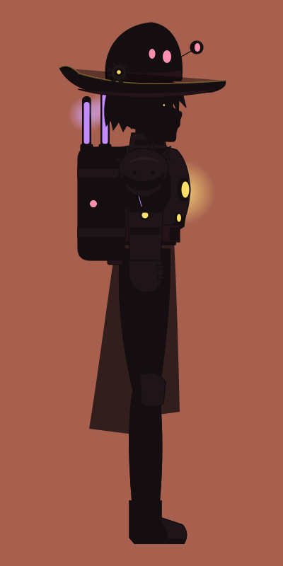 | 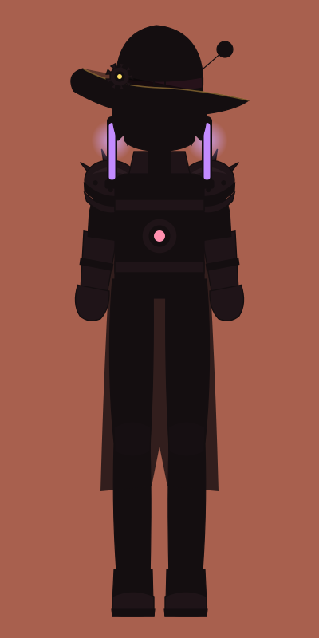 |
| Erzalchemist | 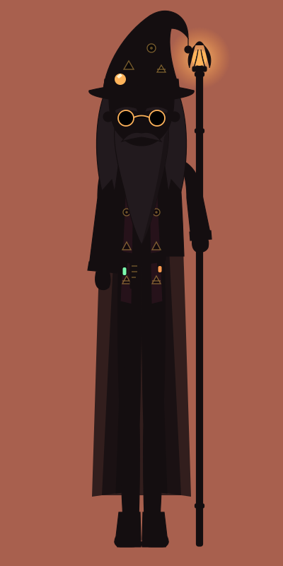 | 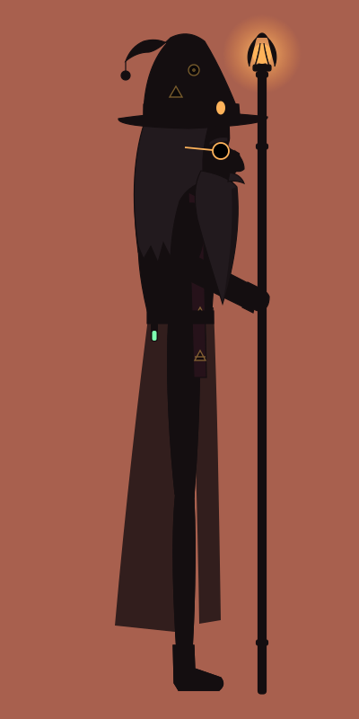 | 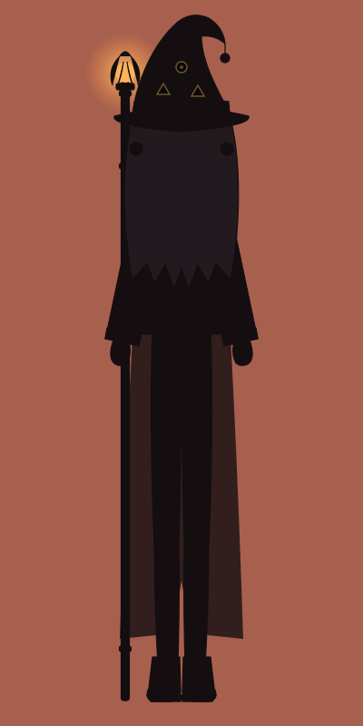 |
| Schmied | 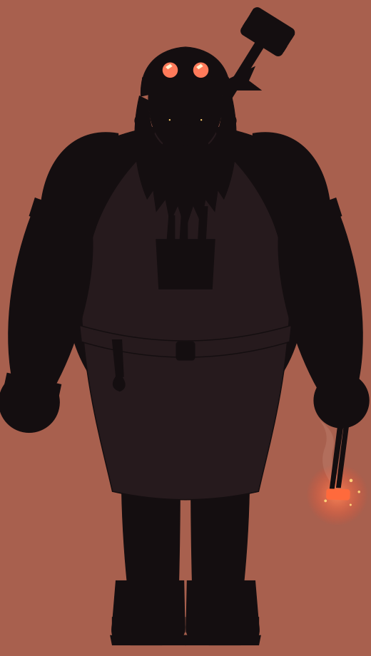 | 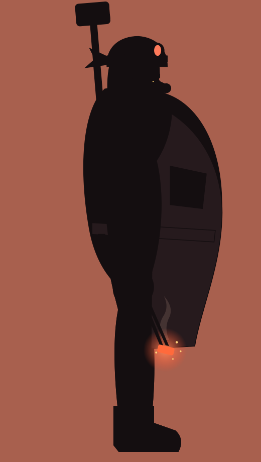 | 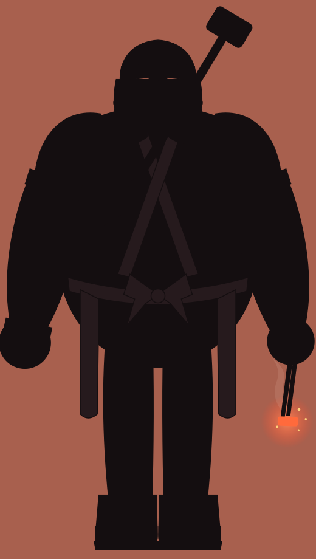 |

Wie bei der Alchemistin sind die Dateien Stilreferenz, keine Assets.

## Gegenstände

- **Im Raum:** gleiche Regeln wie Möbel. Ein Gegenstand, den man aufnehmen kann, trägt mindestens eine Leuchtfarbe, damit er sich von der Silhouette abhebt.
- **Inventar-Icon:** dieselbe Form, aber farbig und hell genug für den UI-Hintergrund `#3b2620`. Kein eigener Hintergrund, etwa 8 Einheiten Rand.
- **Alchemiegegenstände:** Glasgefäß mit Inhalt in der Leuchtfarbe des Stoffs. Gleiche Gefäßform je Gegenstandsart (Glas, Phiole, Flasche), damit Inhalt und Farbe den Unterschied machen.
- **Questgegenstände:** eigene, unverwechselbare Form (Schlüssel, Kristall, Buch), nie als Glasgefäß.

## Animationen

Langsam und sparsam, damit das Bild ruhig bleibt.

| Bewegung | Werte aus der Demo |
|---|---|
| Flamme flackert | Höhe 1 → 1,12, Breite 1 → 0,94, 0,27–0,35 s, hin und zurück |
| Blinzeln | alle 5 s, Höhe kurz auf 0,1 |
| Blasen im Kessel | steigen 34 Einheiten, 1,6 s, versetzt um 0,5 s |
| Leuchten pulsiert | Deckkraft 0,85 → 1, 2 s, hin und zurück |
| Figur im Stand (`idle`) | leichtes Auf und Ab des Körpers |
| Figur läuft (`walk`) | Beine und Arme schwingen gegenläufig |

Figuren-Animationen stehen in `animations.json` ([Asset-Vertrag: Figur](../architektur/asset-vertrag/figur.md)). Animationen im Raum (Flamme, Blasen, Blinzeln) und Grafik, die sich mit dem Zustand ändert (Feuer an, Tür offen, Ranke gewachsen), laufen über Raumteile ([Asset-Vertrag: Raum](../architektur/asset-vertrag/raum.md)).

## Baustein für Claude Design

Diesen Text in jede Vorlage aus dem Briefing unter „Gestaltung“ vor die Beschreibung setzen:

```
Stil: Scherenschnitt im Dämmerlicht. Warmes Gegenlicht aus dem Hintergrund
(Wandverlauf #e8a16a → #9a4e44 → #42243a, Himmel #ffe2a6 → #f29a5e).
Möbel und Objekte als flächige, dunkle Silhouetten ohne schwarze Konturen,
nach Tiefe gestaffelt: hinten #4a2c33, Mitte #3a242b, vorn #2e1c22.
Oberkanten mit dünner Lichtkante #d98a62 (Breite 1.6). Figuren ganz in #140e10,
Anime-Proportionen, ohne Gesicht, erkennbar am Umriss.
Gesättigte Leuchtfarben (#ffcf6b, #7dffb0, #ff9a4f, #5ac8ff, #c77bff) nur an
spielrelevanten Gegenständen. Wenige große Formen, ruhig und gut lesbar.
```

## Von der Demo zum Asset

Die Demo ist ein Stil-Muster, kein Asset. Der Vertrag wurde um Raumteile erweitert, damit alles aus der Demo abbildbar ist. Die übrigen Regeln bleiben, der Generator der Demo wird angepasst ([Entscheidungen](../entscheidungen.md), 2026-11-20).

| Demo | Vertrag | Wer passt an |
|---|---|---|
| Farben über CSS-Klassen in `<style>` | Farben als `fill`- und `stroke`-Attribute | Generator |
| Beschriftungen als `<text>` | Schrift als Pfad oder weglassen | Generator |
| viewBox 1280 × 720 | Räume exakt 1920 × 1080, alle Maße × 1,5 | Generator |
| Raum, Figur und Logik in einer HTML-Datei | je Raum, Figur und Gegenstand eigene Dateien unter `content/` | Generator |
| Figur-Ansichten `#character`, `#characterSide`, `#characterBack` | `view-front`, `view-side`, `view-back` mit `data-part`-Rig | Generator |
| Ein- und Ausblenden per JavaScript (Eisblock, Feuer, Ranke, Tür) | Raumteile mit `visibleIf` | Vertrag erweitert |
| Animationen per CSS | Figuren über `animations.json`, Räume über `animations` in `room.json` | Vertrag erweitert |
| Kesselinhalt färbt sich nach dem Ergebnis (CSS-Variable) | je Farbe ein Raumteil mit `visibleIf` | Generator |

## Offene Punkte

- Abstimmung mit Fabian, danach Status „Festgelegt“ und Eintrag in den [Entscheidungen](../entscheidungen.md).
- Die Engine-Funktion für Raumteile steht im [Katalog](../voranalyse/03-anforderungen.md): FA-E-23 (Raumteile) und FA-E-24 (Raumanimation).
- Kontrast der Leuchtfarben auf den dunklen Silhouetten im echten Spiel prüfen, vor allem `#c9824a` auf `#3a242b`.
- Das Rig der Figuren-Demos (Knie- und Ellbogengelenke, Laufstil je Figur) ist feiner als das Standard-Rig im [Asset-Vertrag: Figur](../architektur/asset-vertrag/figur.md). Bei der Übernahme der ersten Figur (#75) abgleichen.
